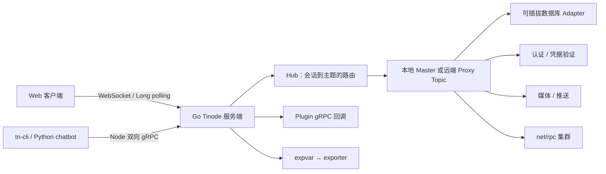

# CallingClaw Tinode：代码库总览

这是一个以 Go 实现的持久化即时通信服务端，提供主题消息、用户与订阅、音视频信令，以及可插拔的存储、认证、推送和媒体后端。仓库还包含数据库初始化器、Python gRPC 客户端/机器人、REST 认证示例和监控适配器。

本 Wiki 面向修改此代码库的开发者，基于当前源码调查，不将示例配置或 README 中的未来设想当成已实现功能。

## 系统全貌

## 从哪里读起

- 新接入请求在 [`serveWebSocket`](../server/hdl_websock.go#L168) 创建会话，在 [`Session.dispatch`](../server/session.go#L465) 统一处理客户端消息；gRPC 只是另一条输入输出通道。
- [`Hub.run`](../server/hub.go#L151) 负责连接和主题之间的路由，主题由 [`topicInit`](../server/init_topic.go#L21) 加载或创建。
- [`PersistentStorageInterface`](../server/store/store.go#L87) 将数据库、认证、验证器和媒体处理组合成统一存储外观。
- 集群主题根据一致性哈希选主；这与客户端的 gRPC 接口不同，集群内部使用 Go `net/rpc`。
- 视频通话复用主题消息做信令，而非由本仓库实现媒体转发。

## 导航

### 架构

- [[wiki/architecture/system|系统边界、配置与启动]]
- [[wiki/architecture/topics|会话、Hub 与主题运行时]]
- [[wiki/architecture/cluster|集群路由与故障转移]]
- [[wiki/architecture/extensions|存储、认证与外部集成]]

### 模块

- [[wiki/modules/server|Go 服务端入口与网络]]
- [[wiki/modules/topics|Hub、Topic 与消息]]
- [[wiki/modules/storage|持久化与数据类型]]
- [[wiki/modules/identity|身份、验证与外部集成]]
- [[wiki/modules/cluster|集群与 Ringhash]]
- [[wiki/modules/calls|WebRTC 呼叫信令]]
- [[wiki/modules/clients|协议、tn-cli 与机器人]]
- [[wiki/modules/operations|初始化、监控与部署]]

### 流程

- [[wiki/flows/connection|连接、hello 与登录]]
- [[wiki/flows/publish|发布并分发消息]]
- [[wiki/flows/subscription|创建或订阅主题]]
- [[wiki/flows/account|账号与凭据验证]]
- [[wiki/flows/video-call|WebRTC 呼叫建立与结束]]
- [[wiki/flows/cluster-routing|跨节点主题转发]]

### 概念与指南

- [[wiki/concepts/uid|UID 与主题命名]] · [[wiki/concepts/subscriptions|订阅与权限]] · [[wiki/concepts/messages|消息信封]]
- [[wiki/concepts/master-proxy|Master / Proxy Topic]] · [[wiki/concepts/drafty|Drafty 内容]]
- [[wiki/guides/build-and-run|构建、初始化与运行]] · [[wiki/guides/extend-backend|扩展后端]]
- [[wiki/guides/operate-cluster|配置与运维集群]] · [[wiki/guides/observability|监控与排障]]

## 范围与约定

重点是 Go 服务端及其外围工具；依赖、生成代码、测试数据和静态资源不展开。源文件链接相对各 Wiki 页面定位到仓库根目录；Wiki 页面通过内部链接构成导航图。

配置以代码字段和注释为准。例如 WebSocket、long polling、gRPC、媒体上传及下载路径的注册集中在 [`main`](../server/main.go#L777-L794)。不要把面向客户端的 `Node` gRPC 服务、服务端调用的 `Plugin` gRPC 服务和集群的 `net/rpc` 混为一谈。

## 后续维护

本 Wiki 的源码锚点为 `22a7c18e9cd695e9a061bf1b8c84175196ef5a15`。源码变更后应按本 Wiki 的生成/刷新规则更新受影响页面，并在 [[wiki/log|维护日志]] 中留下记录。
