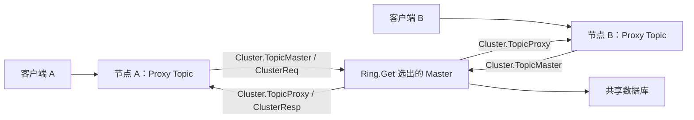
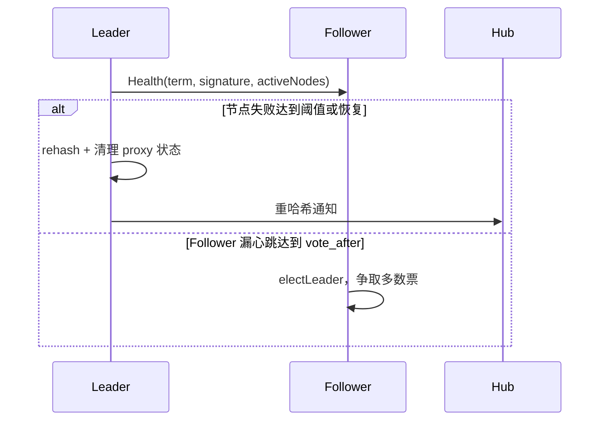

# 集群路由与故障转移

集群把主题分配给节点，并把客户端请求从 Proxy 节点转发到 Master 节点。它使用 Go `net/rpc`，不是面向客户端的 gRPC `Node` 服务。

## 归属与请求路径

[`clusterInit`](../../server/cluster.go#L944-L1036) 解析全部节点和本节点名称，建立一致性哈希环，并给数据库 ID 生成器计算 worker ID。无集群配置时使用 standalone。[`Cluster.start`](../../server/cluster.go#L1046-L1084) 启动重连、异步 RPC 与 proxy-to-master 发送循环，并注册 `net/rpc` 服务。

Hub 用 [`isRemoteTopic`](../../server/cluster.go#L799-L805) 决定本地 Topic 是 Master 还是 Proxy。Proxy 的 [`runProxy`](../../server/topic_proxy.go#L17-L117) 将 join、发布、元数据和会话状态转换为 `ProxyReqType`；Master 的 [`TopicMaster`](../../server/cluster.go#L469-L613) 校验环签名，建立每节点的 multiplex session，并为远端会话构造代理 Session。

回包由 master 的写循环放入 `ClusterResp`，再送到 proxy Topic。广播回包使用通配源会话，定向控制响应则保留原会话 ID 和请求类型。

## Ring 与故障转移

[`Ring.Add`](../../server/ringhash/ringhash.go#L69-L97) 为每个节点生成 20 个虚拟副本并计算环签名；[`Ring.Get`](../../server/ringhash/ringhash.go#L99-L120) 二分定位主题归属。相同环签名用于拒绝过期 Master 请求。

可选 failover 需要至少三个总节点，配置见 [`clusterFailoverConfig`](../../server/cluster_leader.go#L43-L52)。Leader 通过心跳检查失败与恢复； [`sendHealthChecks`](../../server/cluster_leader.go#L151-L196) 重建环、失效代理订阅、清理代理会话并通知 Hub。Follower 漏心跳达到阈值后通过 [`electLeader`](../../server/cluster_leader.go#L198-L257) 获取多数票。

## 运维边界

节点断线还会触发独立的重连与 fingerprint 重启检测；不等同于 failover 选举。重哈希后客户端可能需要重新订阅，不应把它写成完全透明的无感迁移。部署步骤见 [[wiki/guides/operate-cluster|集群指南]]，术语见 [[wiki/concepts/master-proxy|Master / Proxy]]。

[[wiki/modules/cluster|集群模块]] · [[wiki/flows/cluster-routing|转发流程]] · [[wiki/modules/calls|跨节点呼叫信令]]
