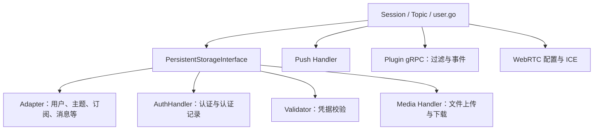

# 存储、认证与外部集成

扩展点围绕注册表和接口组织。`store.Store` 是服务侧统一入口，而不是某一个 SQL 数据库的实现。

## 统一外观与数据适配器

[`PersistentStorageInterface`](../../server/store/store.go#L87-L106) 聚合数据库、认证、验证器、媒体句柄；[`Adapter`](../../server/db/adapter.go#L14-L209) 定义用户、认证记录、主题、订阅、消息、设备、文件和缓存操作。业务代码面向接口，数据库差异由编译进二进制的具体适配器处理。

[`InitAuthLogicalNames`](../../server/store/store.go#L869-L908) 可把外部逻辑认证名映射到实际处理器。例如配置文件注释中的 `basic:rest` 将 basic 协议名交由 REST 实现处理，见 [`tinode.conf`](../../server/tinode.conf#L187-L197)。

## 认证与凭据是不同职责

[`AuthHandler`](../../server/auth/auth.go#L231-L280) 处理认证、添加/更新/删除认证记录、唯一性、标签命名空间和 token/重置参数。[`basic.authenticator`](../../server/auth/basic/auth_basic.go#L70-L151) 校验用户名密码策略，以 bcrypt 保存密码，并可生成可搜索标签。

凭据验证器在启动时按认证等级注册；它们验证邮箱、电话等凭据，不应和“登录密码是否正确”混为一谈。流程见 [[wiki/flows/account|账号与凭据]]。

## 外部集成

- `rest-auth` 是 Flask 示例认证服务，不直接连接数据库；示例数据不能当生产身份存储。
- `Node` gRPC 面向客户端；`Plugin` gRPC 由 Tinode 调用外部插件。Python chatbot 同时是 Node 客户端和 Plugin 服务端，见 [[wiki/modules/clients|客户端与机器人]]。
- 推送、媒体、WebRTC ICE 均有独立配置。大文件走 HTTP 上传/下载路由，与服务端的小消息限制不同。
- 新后端的实现入口和验证方式见 [[wiki/guides/extend-backend|扩展后端指南]]。

[[wiki/modules/storage|存储模块]] · [[wiki/modules/identity|身份与集成模块]] · [[wiki/modules/operations|部署模块]]
