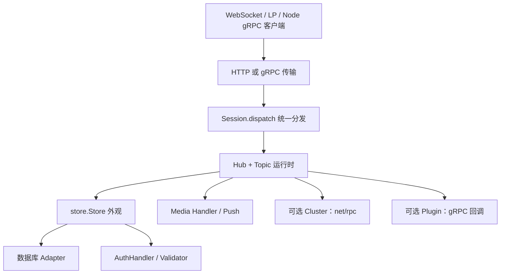

# 系统边界、配置与启动

Go 进程将多种客户端传输、主题运行时和可插拔外部服务组装到一个服务中。入口与配置均集中在 `server` 包，而不是各自独立的微服务。

## 组件与边界

## 启动次序

[`main`](../../server/main.go#L334) 先解析带注释的 JSON 配置和命令行覆盖，随后注册 expvar、可选 pprof 和 [`clusterInit`](../../server/main.go#L413-L415)。数据库在认证初始化之前由 [`store.Store.Open`](../../server/main.go#L439) 打开。

接着依次配置认证逻辑名、受限标签、凭据验证器、消息与订阅限制、媒体、账户 GC、推送和 [`initVideoCalls`](../../server/main.go#L659-L676)。随后创建 SessionStore、Hub，启动集群、插件、用户缓存和可选 gRPC 服务。HTTP 路由最后注册：[`main`](../../server/main.go#L777-L794) 包含 `/v0/channels`、`/v0/channels/lp`、文件上传/下载及静态内容。

配置结构 [`configType`](../../server/main.go#L255-L332) 定义了 HTTP、gRPC、TLS、API key、静态文件和子系统的字段。示例 [`tinode.conf`](../../server/tinode.conf#L1-L43) 展示默认监听 `:6060` 和客户端 gRPC `:16060`；示例值不是当前部署的运行证明。

## 设计要点

- **传输与业务解耦**：WebSocket JSON 和 gRPC protobuf 在解码后共用 `Session.dispatch`。
- **主题串行化**：Hub 管理全局主题缓存，每个活动 Topic 用自己的 goroutine 和 channel 处理事件，见 [[wiki/architecture/topics|主题运行时架构]]。
- **接口式扩展**：外部后端经过 store 外观和注册表注入，见 [[wiki/architecture/extensions|扩展架构]]。
- **共享持久层**：集群负责内存中的主题归属与转发，不代替共享数据库。
- **初始化器独立**：`tinode-db` 与运行服务使用相同 store 接口，但职责是建库、升级和加载样例数据，见 [[wiki/guides/build-and-run|构建与运行指南]]。

## 相关页面

[[wiki/modules/server|服务入口模块]] · [[wiki/flows/connection|连接流程]] · [[wiki/concepts/messages|消息信封]] · [[wiki/OVERVIEW|总览]]
