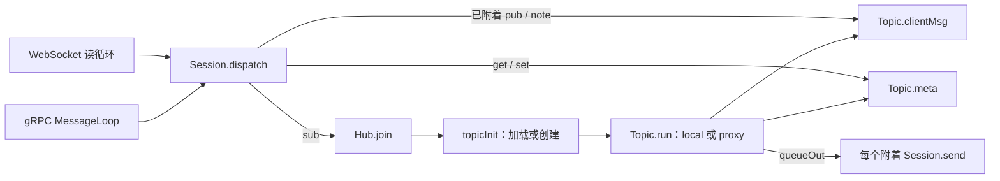

# 会话、Hub 与主题运行时

服务端以一个中心 Hub 和多个 Topic goroutine 管理在线状态。Session 表示一条网络或代理连接，而不是持久订阅本身。

## 三层职责

**Session** 保存传输句柄、用户身份和会话到主题的通道映射。`Subscription` 在这里是包含 `broadcast`、`done`、`meta`、`supd` 的内存结构，见 [`server/session.go`](../../server/session.go#L163-L177)；它不等于数据库的持久订阅。

[`Session.dispatch`](../../server/session.go#L465-L510) 先经过插件、补全身份与时间戳，再检查 `{hi}` 和登录状态并选择处理器。已附着的发布通常直接经会话的 `Subscription.broadcast` 送到 Topic，并非每条消息都经过 `Hub.routeCli`。

**Hub** 用 `sync.Map` 按展开后的名称保存活动主题。[`Hub.run`](../../server/hub.go#L151-L220) 接收 join，创建 paused 的 Topic 并异步执行 `topicInit`，防止数据库加载阻塞主路由循环。队列拥塞时返回 503 或记录过载，而非无限等待。

**Topic** 区分连接和持久用户状态：`sessions` 保存附着的连接，`perUser` 保存订阅读数、权限等缓存。[`topicInit`](../../server/init_topic.go#L21-L61) 按原始名称分派 `me`、`fnd`、P2P、群组、频道、`sys`、`slf` 初始化。成功后解除 paused，再由 [`Topic.run`](../../server/topic.go#L218-L224) 选择本地或代理循环。

## 串行与背压

本地 `runLocal` 在一个 select 中处理注册、注销、发布、元数据、状态更新、计时器与退出，见 [`server/topic.go`](../../server/topic.go#L568-L618)。出站通过 `Session.send` 解耦；[`broadcastToSessions`](../../server/topic.go#L1287-L1372) 为每个接收者复制消息、调整主题名和过滤权限，无法入队的连接会被移除。

## 关键不变量

- `me` 展开成当前用户 ID，P2P 的内部名称由双方 UID 组成；发送时再按接收者还原，见 [[wiki/concepts/uid|UID 与主题命名]]。
- 普通 leave 断开会话；只有 `Unsub` 才删除持久订阅。
- 主题加载期间 paused；初始化失败会从 Hub 删除并拒绝/重排等待请求。
- 集群下，同样的 Topic 接口可以运行 proxy 循环，见 [[wiki/architecture/cluster|集群架构]]。

## 相关页面

[[wiki/modules/topics|主题模块]] · [[wiki/flows/subscription|订阅流程]] · [[wiki/flows/publish|发布流程]] · [[wiki/concepts/subscriptions|订阅与权限]]
