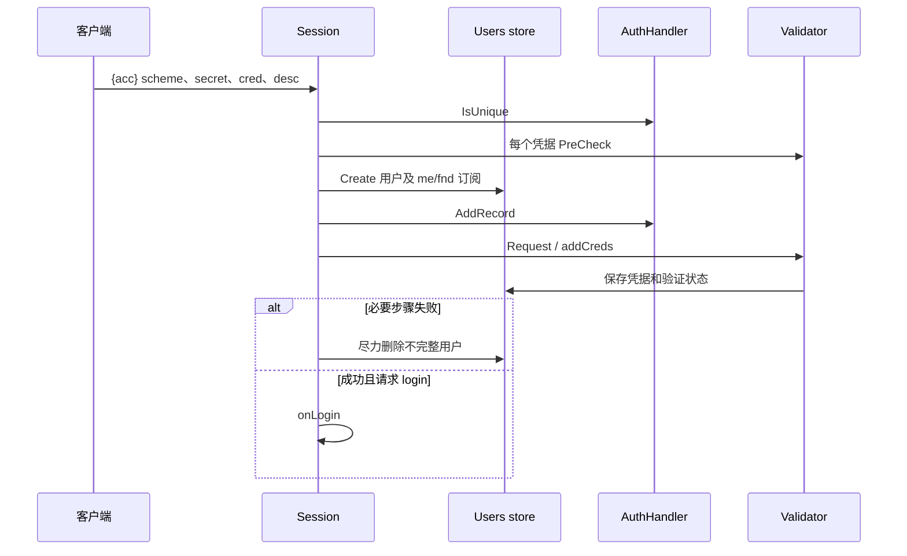

# 账号与凭据验证

账号创建会组合用户记录、认证记录和邮箱/电话等凭据。各阶段失败时应避免留下可登录的不完整账号。

[`replyCreateUser`](../../server/user.go#L26-L218) 先解析逻辑认证名、检查唯一性、状态和受限标签，然后逐个 pre-check 凭据。`Users.Create` 在 [`store.go`](../../server/store/store.go#L292-L329) 创建用户并建立 `me`/`fnd` 订阅，接着才添加认证记录。

缺必需凭据或认证记录失败会尽力删除不完整用户。临时 token 可用于凭据验证或重置流程，但 token 不是绕过权限的通用凭据。

登录时 [`Session.login`](../../server/session.go#L925-L997) 可处理 challenge、账号状态与未验证凭据。`AuthHandler` 证明身份，`Validator` 处理邮箱/电话等验证；两者区别见 [[wiki/modules/identity|身份模块]]。

REST 认证示例见 [`rest-auth/auth.py`](../../rest-auth/auth.py#L27-L101)，其 dummy 数据只用于演示。重置流程应避免泄露账号是否存在。

[[wiki/architecture/extensions|扩展接口]] · [[wiki/guides/extend-backend|新增认证/验证器]] · [[wiki/flows/connection|登录流程]]
