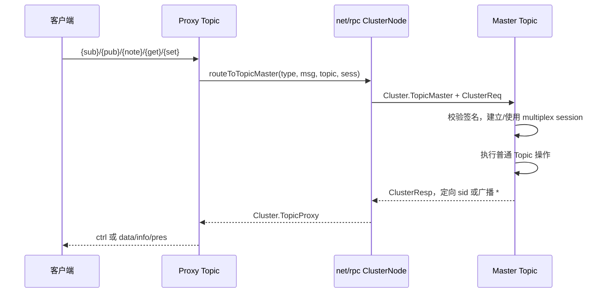

# 跨节点主题转发

当客户端所在节点不是主题的 Master，本地 Topic 作为 Proxy，只保存本地连接并转发操作。

[`runProxy`](../../server/topic_proxy.go#L17-L117) 将 join、broadcast、meta、leave 等事件交给集群。[`routeToTopicMaster`](../../server/cluster.go#L837-L897) 创建包含签名、fingerprint、展开主题名和会话快照的 `ClusterReq`，选主后投递。

[`proxyToMaster`](../../server/cluster.go#L385-L422) 调用 `Cluster.TopicMaster`；Master 用 `ClusterResp` 经 `Cluster.TopicProxy` 返回。[`proxyMasterResponse`](../../server/topic_proxy.go#L175-L266) 区分广播和定向回包，成功 join 后才在 Proxy 上附着 Session。

队列有界：proxy-to-master 默认基础 buffer 为 64，满时只短暂等待，见 [`cluster.go`](../../server/cluster.go#L27-L34) 和 [`proxyToMasterAsync`](../../server/cluster.go#L397-L411)。错误应表现为集群不可达或过载，不能承诺无限排队。

[[wiki/architecture/cluster|故障转移]] · [[wiki/concepts/master-proxy|角色与不变量]] · [[wiki/modules/cluster|集群模块]]
