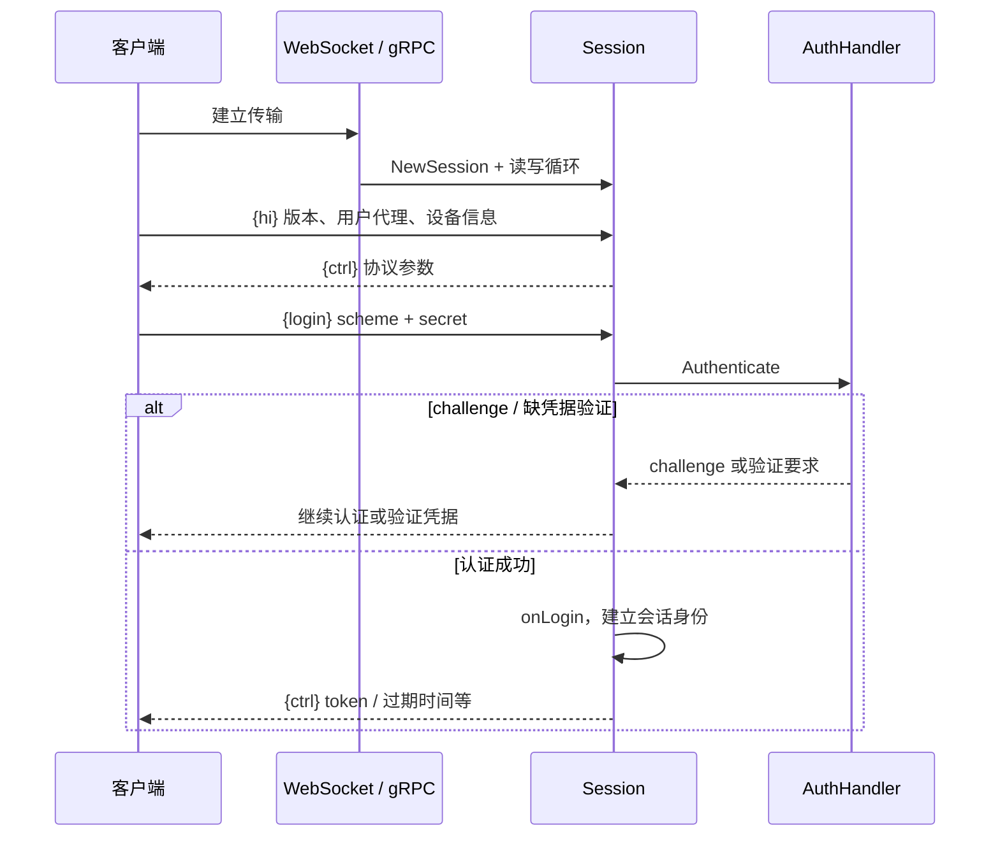

# 连接、hello 与登录

本流程从客户端打开网络连接到获得已认证 Session。`{hi}` 协商协议，`{login}` 才建立用户身份；连接成功不等于登录成功。

WebSocket 入口 [`serveWebSocket`](../../server/hdl_websock.go#L168-L211) 先检查 API key，然后升级连接并创建会话。gRPC 在 [`MessageLoop`](../../server/hdl_grpc.go#L147-L190) 复用同一套 Session 语义。

[`Session.dispatch`](../../server/session.go#L465-L619) 检查是否已发送 hi 和是否允许未登录操作，再分派到 [`hello`](../../server/session.go#L739-L884) 或 [`login`](../../server/session.go#L924-L997)。hello 不自动登录；[`onLogin`](../../server/session.go#L1057-L1108) 建立身份，但不自动订阅 `me`。

登录认证由 [[wiki/modules/identity|AuthHandler]] 完成，可能包含多步 challenge、账号状态检查和必需凭据验证。客户端随后通过 `{sub}` 显式附着主题，见 [[wiki/flows/subscription|订阅流程]]。

[[wiki/concepts/messages|消息信封]] · [[wiki/modules/clients|tn-cli 客户端]] · [[wiki/architecture/topics|会话运行时]]
