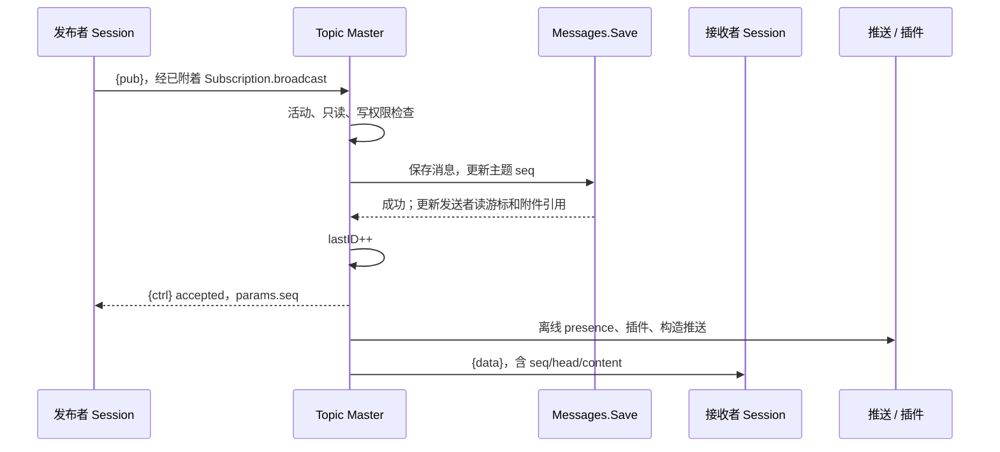

# 发布并分发消息

这里以普通主题 `{pub}` 为例，覆盖权限检查、持久化、序号分配、回执、在线广播和离线通知。

`{pub}` 不总是再经过 Hub：Session 附着后通过内存 `Subscription` 直接进入 Topic。Master 在 [`handlePubBroadcast`](../../server/topic.go#L1092-L1134) 检查主题状态与只读状态。

[`saveAndBroadcastMessage`](../../server/topic.go#L999-L1088) 检查 `want & given` 的写权限，清理伪造的 sender 头，再调用 [`Messages.Save`](../../server/store/store.go#L682-L727)。**数据库成功之后才增加 `lastID` 并广播**，避免广播一个未持久化的消息序号。

[`broadcastToSessions`](../../server/topic.go#L1287-L1373) 处理接收者特定的主题名称、权限和队列。`no_echo` 可跳过原会话，但不会改变已持久化消息。推送和 presence 是额外的副作用，不代替消息存储。

若头中包含 WebRTC 呼叫标记，则还需要满足 P2P 与 ICE 条件，见 [[wiki/flows/video-call|呼叫流程]]。跨节点时先走 [[wiki/flows/cluster-routing|集群转发]]。

[[wiki/modules/topics|Topic 模块]] · [[wiki/concepts/subscriptions|权限]] · [[wiki/concepts/drafty|Drafty]]
