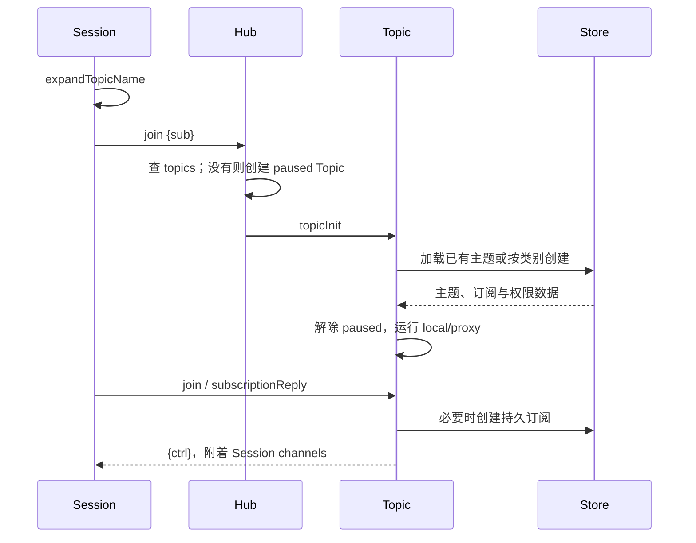

# 创建或订阅主题

客户端看到的 `me`、P2P 对端用户名和频道名，会先展开为全局可路由名称，再进入 Hub。

[`expandTopicName`](../../server/session.go#L1332-L1367) 将 `me/fnd/slf` 映射到当前用户，`usr...` 映射为双方确定的 P2P 名，`chn...` 转成内部群组名。自己与自己创建 P2P 会被拒绝。

[`Hub.run`](../../server/hub.go#L151-L220) 异步调用 [`topicInit`](../../server/init_topic.go#L21-L135)，以免存储加载阻塞 Hub。`topicInit` 按类别处理 me、fnd、P2P、grp/chn、sys 和 slf；失败时清理 Hub 中未完成的主题。

[`subscriptionReply`](../../server/topic.go#L1376-L1483) 负责创建/更新持久订阅并添加内存 Session。持久订阅和在线附着是两层：普通 `{leave}` 通常只断开连接，不等于 `Unsub` 删除订阅。

[[wiki/architecture/topics|Topic 生命周期]] · [[wiki/concepts/uid|名称展开]] · [[wiki/concepts/subscriptions|订阅与权限]]
