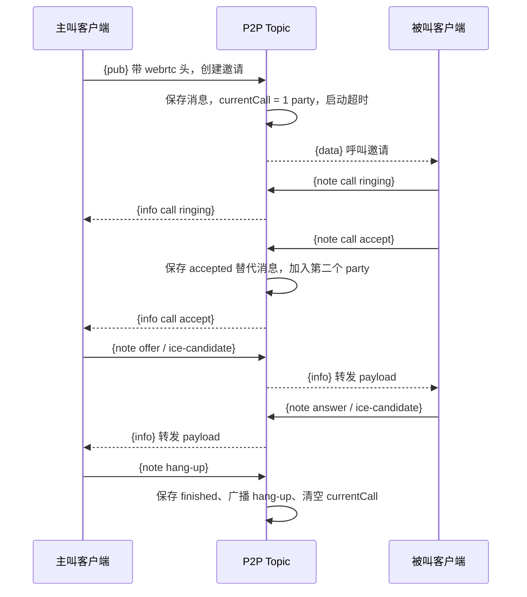

# WebRTC 呼叫建立与结束

呼叫通过 P2P 主题中的 `{pub}` 邀请和 `{note what=call}` 事件进行。SDP/ICE payload 由服务端转发；实际媒体连接在客户端与 ICE 基础设施之间建立。

[`handleCallInvite`](../../server/calls.go#L222-L237) 记录邀请的 seq 和内容。[`handleCallEvent`](../../server/calls.go#L241-L373) 验证 seq 和参与者身份：accept 只允许尚未建立时的被叫；offer/answer/ICE 只允许已建立的两个 party。

接受后停止建立计时器。结束时 [`maybeEndCallInProgress`](../../server/calls.go#L377-L430) 区分 finished、missed、declined、disconnected，并用 [`messageHead`](../../server/calls.go#L174-L193) 写入替代关系、状态和可选时长。

[[wiki/modules/calls|呼叫模块]] · [[wiki/concepts/messages|info 与 data]] · [[wiki/flows/publish|消息保存]]
