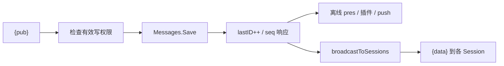

# Hub、Topic 与消息

这是消息业务的核心：管理主题生命周期、在线附着、持久订阅、消息保存和广播。

| 单元 | 职责 | 源码锚点 |
| --- | --- | --- |
| `Hub` | 活动主题缓存、join、消息路由与注销 | [`server/hub.go`](../../server/hub.go#L151-L344) |
| `topicInit` | 按类别加载或创建主题 | [`server/init_topic.go`](../../server/init_topic.go#L21-L135) |
| `Topic.run` | 选择本地或 proxy 事件循环 | [`server/topic.go`](../../server/topic.go#L218-L224) |
| `subscriptionReply` | 建订阅并绑定 Session | [`server/topic.go`](../../server/topic.go#L1376-L1483) |
| `saveAndBroadcastMessage` | 权限、持久化、序号和扇出 | [`server/topic.go`](../../server/topic.go#L999-L1088) |

## 消息落地与广播

[`saveAndBroadcastMessage`](../../server/topic.go#L999-L1037) 以 `want & given` 检查写权限并调用存储；只有存储成功后才增加 `lastID`。发送者若有读权限，存储层更新其 read/recv 游标；随后返回带 `seq` 的 accepted 控制响应。[`broadcastToSessions`](../../server/topic.go#L1287-L1373) 再逐会话复制、改名、过滤和入队。

附件 URL 在存储时由媒体处理器映射为文件 ID，见 [`messagesMapper.Save`](../../server/store/store.go#L682-L727)。附件本身不走消息正文上传。

## 与相邻模块的关系

Topic 在集群下可作为 Master 或 Proxy，见 [[wiki/modules/cluster|集群模块]]；带 WebRTC 头的 P2P 发布会进一步创建呼叫，见 [[wiki/modules/calls|呼叫模块]]。

[[wiki/architecture/topics|并发架构]] · [[wiki/flows/publish|发布流程]] · [[wiki/flows/subscription|订阅流程]] · [[wiki/concepts/messages|消息模型]]
